# HỆ THỐNG QUẢN LÝ SỰ KIỆN VÀ BÁN VÉ (CONCERT & EVENT TICKET MANAGEMENT)

> **Học phần:** COMP1019 — Lập trình Windows  
> **Giảng viên hướng dẫn:** ThS. Lê Thanh Thoại — Khoa Công nghệ Thông tin, Trường Đại học Sư phạm TP.HCM (HCMUE)  
> **Học kỳ / Năm học:** Học kỳ 1 — Năm học 2026–2027  
> **Nhóm thực hiện:** Nhóm 3  
> **Repository:** [https://github.com/lekhoanohope-blip/QuanLySuKienVaBanVe](https://github.com/lekhoanohope-blip/QuanLySuKienVaBanVe)  

---

## MỤC LỤC
1. [Giới thiệu & Huy hiệu dự án](#1-giới-thiệu--huy-hiệu-dự-án)
2. [Tổng quan các màn hình chức năng (Screenshots)](#2-tổng-quan-các-màn-hình-chức-năng-screenshots)
3. [Tính năng nghiệp vụ & Điểm nhấn kỹ thuật](#3-tính-năng-nghiệp-vụ--điểm-nhấn-kỹ-thuật)
4. [Kiến trúc hệ thống & Cấu trúc thư mục](#4-kiến-trúc-hệ-thống--cấu-trúc-thư-mục)
5. [Yêu cầu môi trường (Prerequisites)](#5-yêu-cầu-môi-trường-prerequisites)
6. [Hướng dẫn cài đặt & Khởi chạy (Installation & Setup)](#6-hướng-dẫn-cài-đặt--khởi-chạy-installation--setup)
7. [Tài khoản trải nghiệm (Demo Credentials)](#7-tài-khoản-trải-nghiệm-demo-credentials)
8. [Xử lý lỗi thường gặp trên WinForms (Troubleshooting)](#8-xử-lý-lỗi-thường-gặp-trên-winforms-troubleshooting)
9. [Kiểm thử (Testing) & Thành viên thực hiện](#9-kiểm-thử-testing--thành-viên-thực-hiện)

---

## 1. Giới thiệu & Huy hiệu dự án

Hệ thống **Quản lý sự kiện và bán vé** là ứng dụng desktop xây dựng trên nền tảng **C# Windows Forms (.NET Framework 4.7.2)** kết hợp bộ điều khiển giao diện **Guna.UI2**. Ứng dụng hỗ trợ quy trình vận hành tại quầy vé cho các sự kiện biểu diễn, hội thảo và nhà hát: từ quản lý danh mục sự kiện, lịch suất diễn, cấu hình phân khu theo hạng vé (VIP, Phổ thông, Thường), bán vé và giữ ghế tạm thời tại quầy, quản lý đơn vé, xử lý đổi/hủy vé theo quy định thời gian, xuất vé PDF kèm mã vạch Code 128, đến thống kê báo cáo doanh thu.

### Huy hiệu hệ thống (Badges)

[](https://github.com/lekhoanohope-blip/QuanLySuKienVaBanVe/actions/workflows/build.yml)
[](https://learn.microsoft.com/en-us/dotnet/csharp/)
[](https://dotnet.microsoft.com/download/dotnet-framework/net472)
[](https://learn.microsoft.com/en-us/dotnet/desktop/winforms/)
[](https://gunaui.com/)
[](https://www.microsoft.com/sql-server)
[](http://www.pdfsharp.net/)
[](https://github.com/micjahn/ZXing.Net)

---

## 2. Tổng quan các màn hình chức năng (Screenshots)

### 2.1. Phân hệ Bán vé tại quầy (POS), Giữ chỗ & Thanh toán

| Sơ đồ phân khu bán vé (`FrmBanVe`) | Hộp thoại chọn nhanh số lượng vé (`FrmChonSoLuongVe`) |
| :---: | :---: |
| 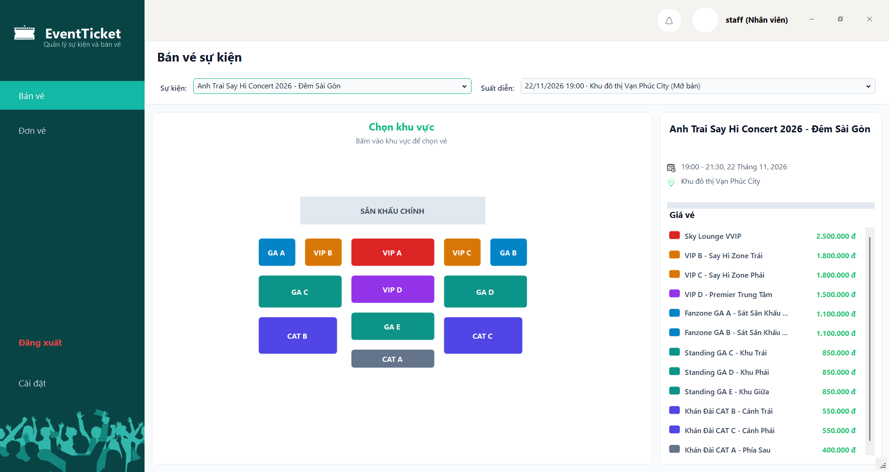 | 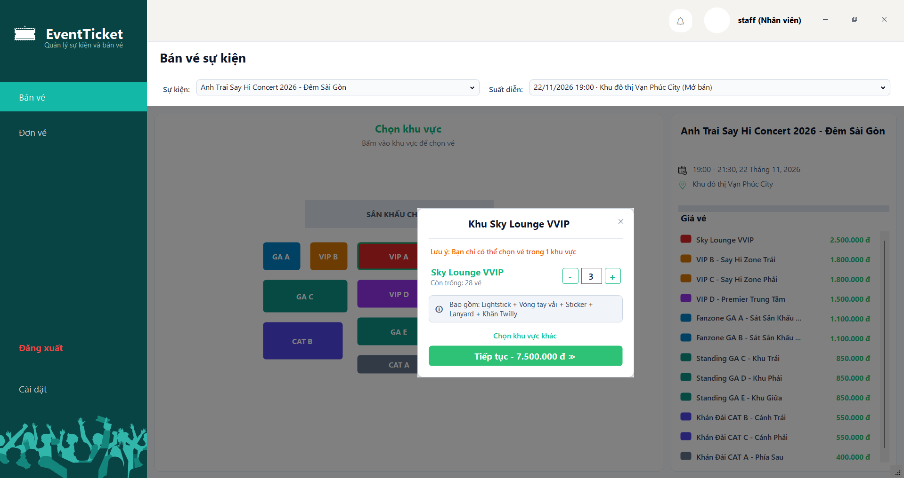 |
| *Hiển thị trực quan các phân khu theo màu sắc, bảng giá và số ghế trống thời gian thực* | *Nhập số lượng vé theo phân khu, hệ thống tự động chọn và giữ tạm các ghế khả dụng* |

| Xác nhận thanh toán đa phương thức (`FrmThanhToan`) | Xem trước phôi vé in & Barcode Code 128 (`FrmInVe`) |
| :---: | :---: |
| 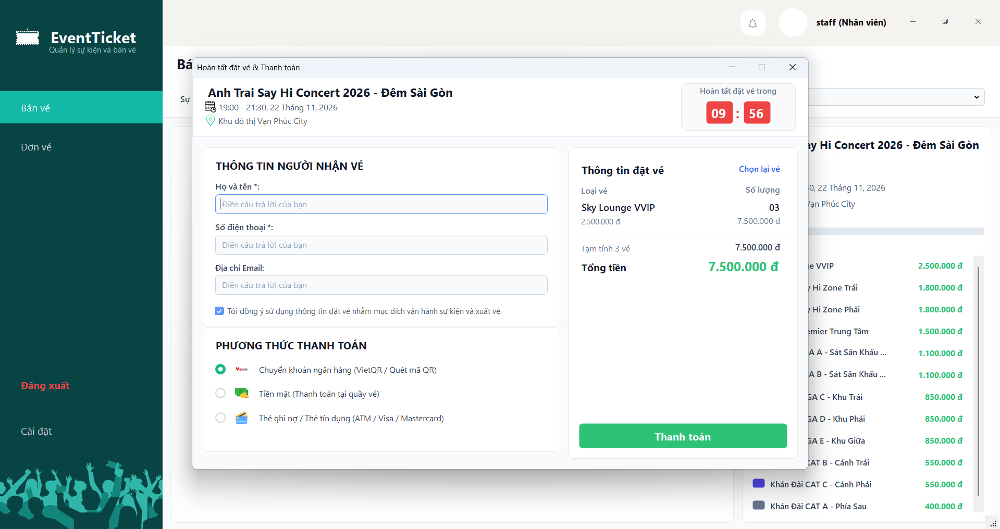 | 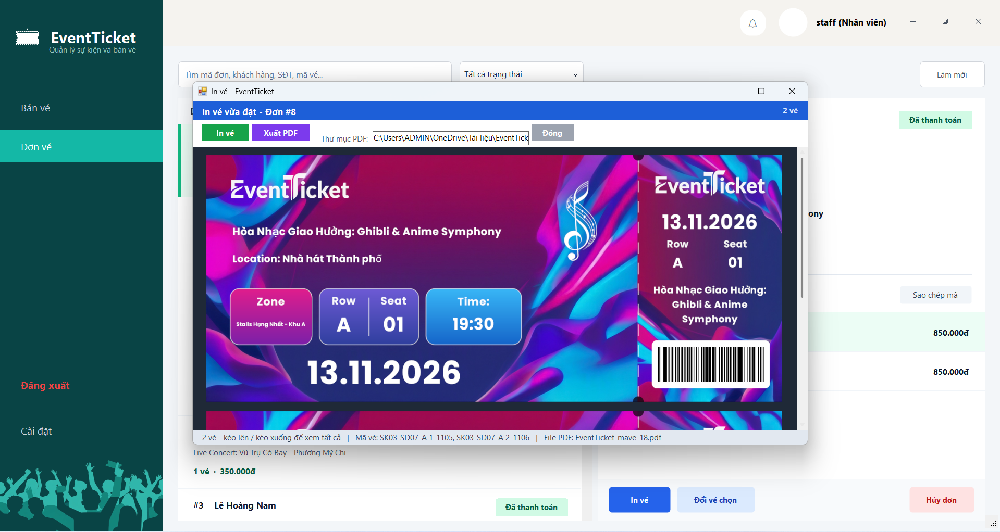 |
| *Ghi nhận thanh toán Tiền mặt, VietQR, Thẻ ATM/Visa và liên kết thông tin khách hàng* | *Phôi vé đồ họa 210x90mm kèm cuống vé xé rời và mã vạch Code 128* |

---

### 2.2. Quản lý Đơn vé & Nghiệp vụ Đổi / Hủy vé

| Quản lý đơn vé 2 cột Master-Detail (`FrmQuanLyDonVe`) | Nghiệp vụ Đổi vé & Tính chênh lệch giá (`FrmDoiVe`) |
| :---: | :---: |
| 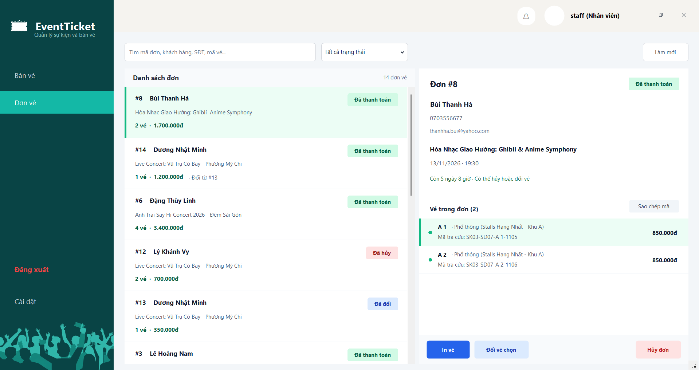 | 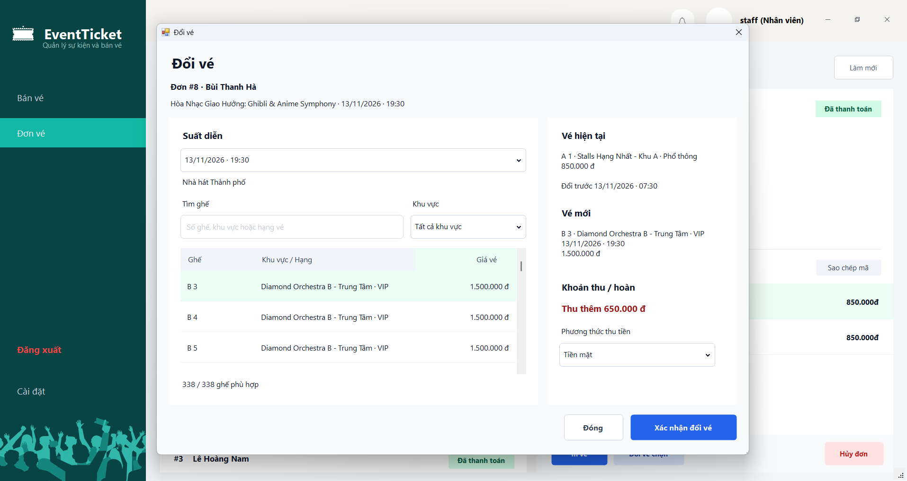 |
| *Tra cứu đơn vé theo mã đơn, khách hàng, ngày đặt và trạng thái (`DaThanhToan`, `DaDoi`, `DaHuy`)* | *Kiểm tra điều kiện trước 12h, chọn ghế mới và tự động tính phụ thu / hoàn tiền* |

---

### 2.3. Quản trị Sự kiện, Suất diễn & Phân khu

| Quản lý danh mục Sự kiện (`FrmQuanLySuKien`) | Quản lý lịch Suất diễn (`FrmQuanLySuatDien`) |
| :---: | :---: |
| 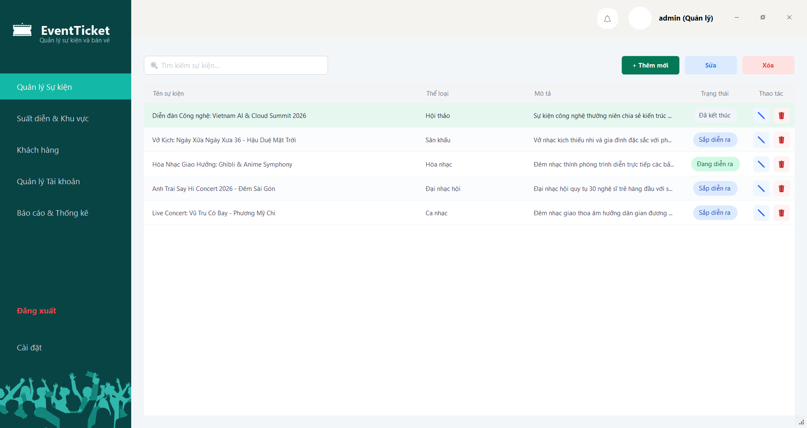 | 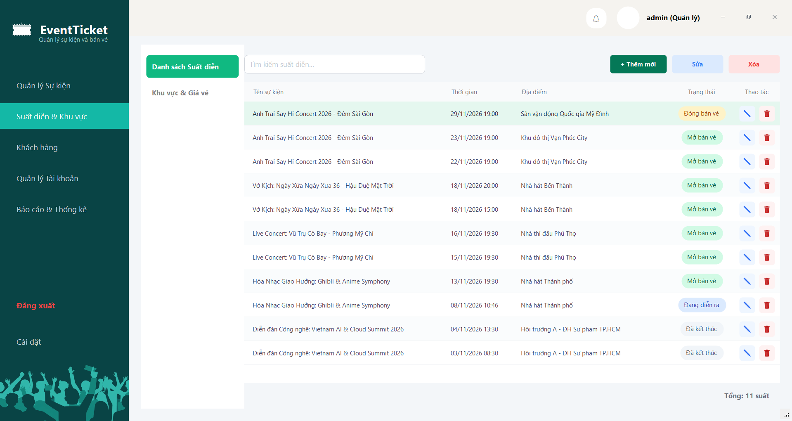 |
| *Danh mục sự kiện, tìm kiếm không dấu, cập nhật trạng thái và ràng buộc xóa* | *Lên lịch diễn, chọn loại sơ đồ sân khấu (Catwalk, Arena, Grid), in danh sách khách* |

| Cấu hình Phân khu & Bảng giá vé (`FrmQuanLyKhuVuc`) | Báo cáo Doanh thu & Tỷ lệ lấp đầy (`FrmBaoCao`) |
| :---: | :---: |
| 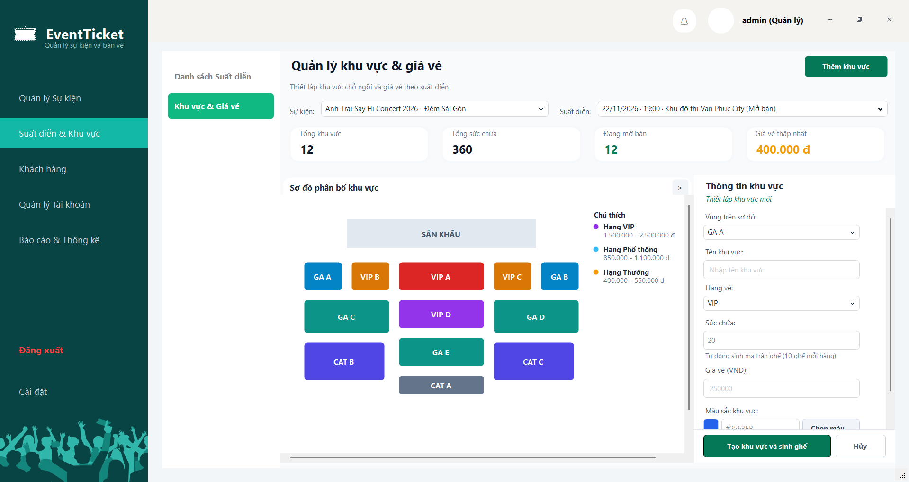 | 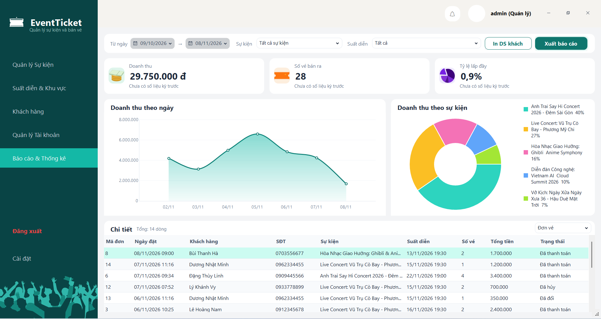 |
| *Cấu hình mã vùng, hạng vé, đơn giá, màu sắc và tự động sinh ma trận ghế* | *3 thẻ KPI tăng trưởng, biểu đồ xu hướng doanh thu và cơ cấu hạng vé* |

---

### 2.4. Quản lý Khách hàng & Tài khoản người dùng

| Quản lý hồ sơ Khách hàng (`FrmKhachHang`) | Quản lý Tài khoản & Nhân sự (`FrmNhanVien`) |
| :---: | :---: |
| 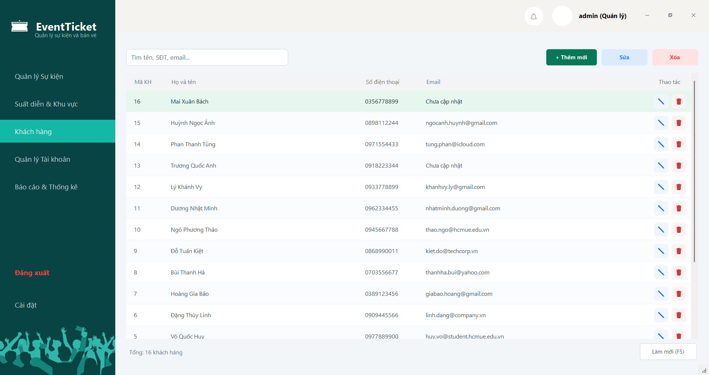 | 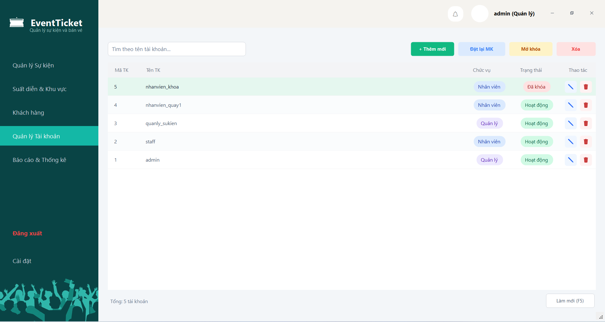 |
| *Tìm kiếm đa trường (tên có dấu/không dấu, SĐT, email), thêm, sửa và kiểm tra đơn vé* | *Cấp phát tài khoản nhân viên, đặt lại mật khẩu và khóa/mở khóa tài khoản* |

| Xác thực Đăng nhập hệ thống (`FrmDangNhap`) | |
| :---: | :---: |
| 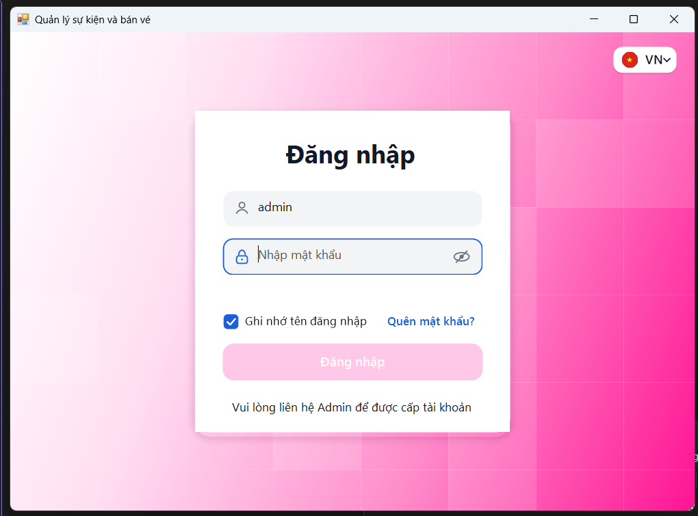 | |
| *Xác thực đăng nhập bảo mật với mật khẩu băm một chiều SHA-256 và phân quyền* | |

---

## 3. Tính năng nghiệp vụ & Điểm nhấn kỹ thuật

### 3.1. Các luồng nghiệp vụ chính

1. **Quản trị Sự kiện, Suất diễn & Sơ đồ phân khu:**
   - Hỗ trợ 3 mẫu sơ đồ sân khấu thông qua trường `LoaiSoDo` của bảng `SuatDien`:
     - `1`: Sơ đồ Sân khấu chữ T (Catwalk)
     - `2`: Sơ đồ Hình chữ nhật (Arena)
     - `3`: Sơ đồ Lưới (Khán phòng Nhà hát)
   - Trên `FrmQuanLyKhuVuc`, mỗi phân khu được ánh xạ với một mã vùng (`MaVung`), hạng vé (`VIP`, `Phổ thông`, `Thường`), mã màu hex (`#RRGGBB`) và tổng số ghế (`TongSoGhe`). Khi thêm hoặc tăng sức chứa phân khu, hệ thống tự động sinh các bản ghi ghế (`Hang`, `Cot`, `MaGheHienThi`) trong bảng `Ghe`.
   - Hỗ trợ xem và in danh sách khách hàng tham dự theo từng suất diễn (`InDanhSachKhach.cs`).

2. **Bán vé theo phân khu & Cơ chế giữ ghế tạm thời (Seat Hold):**
   - Màn hình `FrmBanVe` hiển thị trực quan sơ đồ các phân khu của suất diễn cùng số ghế trống/tổng số ghế.
   - Khi nhân viên chọn một phân khu và nhập số lượng vé cần mua tại `FrmChonSoLuongVe`, hệ thống tự động chọn các ghế đang ở trạng thái `Trong` trong phân khu đó và chuyển sang trạng thái `DangGiu` kèm mã phiên `MaPhienGiu` (`UNIQUEIDENTIFIER`) và thời điểm `ThoiGianGiu`.
   - Phiên giữ ghế có hiệu lực **10 phút (600 giây)**. Các ghế giữ quá hạn sẽ được tự động giải phóng về trạng thái `Trong` khi truy vấn trạng thái ghế hoặc khi nhân viên hủy thao tác/đóng form.
   - *(Lưu ý: Luồng bán vé hiện tại cấp ghế tự động theo số lượng trong phân khu đã chọn; việc chọn đích danh từng ghế cụ thể được hỗ trợ trong màn hình Đổi vé `FrmDoiVe`).*

3. **Ghi nhận thanh toán & Quản lý thông tin khách hàng:**
   - Tự động kiểm tra số điện thoại khách hàng (chuẩn 10 chữ số bắt đầu bằng `0`) để cập nhật hoặc thêm mới hồ sơ khách hàng ngay trong giao dịch đặt vé.
   - Cho phép chọn và lưu phương thức thanh toán vào bảng `ThanhToan`: **Tiền mặt (`TienMat`)**, **Chuyển khoản VietQR (`ChuyenKhoan`)**, hoặc **Thẻ ngân hàng ATM/Visa (`TheNganHang`)**. *(Ứng dụng ghi nhận phương thức thanh toán nội bộ tại quầy, không tích hợp cổng thanh toán trực tuyến hay đối soát ngân hàng tự động).*
   - Kiểm tra đồng bộ giá vé: Nếu đơn giá phân khu trong CSDL thay đổi so với thời điểm bắt đầu giữ ghế, hệ thống dừng giao dịch và thông báo mức giá mới để nhân viên xác nhận lại với khách hàng.

4. **Nghiệp vụ Đổi vé & Hủy vé:**
   - **Hủy vé (`DonVeBLL.HuyDonVe`):**
     - Chỉ cho phép hủy khi đơn vé đang ở trạng thái `DaThanhToan`, suất diễn chưa bắt đầu và thời điểm hủy cách giờ diễn **ít nhất 24 giờ** (`DATEDIFF(MINUTE, GETDATE(), ThoiGianBatDau) >= 1440`).
     - Cập nhật trạng thái đơn vé và các vé con sang `DaHuy`, giải phóng ghế về `Trong`, ghi nhận giao dịch hoàn tiền âm vào bảng `ThanhToan` và lưu log vào bảng `NhatKy`.
   - **Đổi vé (`DonVeBLL.DoiVe`):**
     - Chỉ cho phép đổi khi vé đang `HopLe` và thời điểm đổi cách giờ diễn **ít nhất 12 giờ** (`>= 720` phút).
     - Cho phép chọn ghế mới đang `Trong` thuộc bất kỳ phân khu mở bán nào của cùng suất diễn, tự động tính chênh lệch: $\Delta = \text{GiaVeMoi} - \text{GiaVeCu}$.
     - Đánh dấu vé cũ thành `DaDoi` (hoặc toàn bộ đơn cũ thành `DaDoi` nếu đơn chỉ có 1 vé), giải phóng ghế cũ, tạo đơn vé mới gắn khóa ngoại `MaDonGoc` trỏ về đơn ban đầu, cấp mã vé mới và ghi nhận khoản thu thêm ($\Delta > 0$) hoặc hoàn tiền ($\Delta < 0$).

5. **In vé GDI+ & Xuất tệp PDF kèm mã vạch Code 128:**
   - `TicketRenderer.cs` sử dụng `System.Drawing` (GDI+) để vẽ phôi vé ở độ phân giải 300 DPI theo kích thước chuẩn **210mm x 90mm**, chia làm phần Thân vé và Cuống vé ngăn cách bởi đường cắt răng cưa.
   - Sử dụng thư viện **ZXing.Net** sinh mã vạch tuyến tính chuẩn **Code 128** (`BarcodeFormat.CODE_128`) biểu diễn chuỗi `MaVeCode` trên cuống vé.
   - `TicketPdfExporter.cs` kết xuất phôi vé thành ảnh `Bitmap` (PNG) trong bộ nhớ rồi nhúng vào trang tài liệu **PDFsharp** có kích thước đúng 210mm x 90mm, mặc định lưu tại `Documents\EventTicket\VeIn`.

6. **Báo cáo & Thống kê (`FrmBaoCao`):**
   - Tổng hợp doanh thu thực thu, số vé hợp lệ đã bán và tỷ lệ lấp đầy ghế theo bộ lọc Sự kiện, Suất diễn và khoảng thời gian (tự động so sánh % tăng trưởng với kỳ liền trước có cùng độ dài).
   - Biểu diễn trực quan bằng biểu đồ đường (doanh thu theo ngày/tháng/năm), biểu đồ tròn (tỷ trọng theo hạng vé) và hỗ trợ xuất bảng dữ liệu chi tiết ra tệp Excel `.xlsx`.

---

### 3.2. Điểm nhấn kỹ thuật (Technical Highlights)

#### 1. Tổ chức mã nguồn theo kiến trúc 3-Tier (Single-Project 3-Tier)
Mã nguồn được phân tách thành các tầng trách nhiệm rõ ràng trong một project duy nhất, chia thư mục con theo từng phân hệ nghiệp vụ (`BanVe`, `BaoCao`, `Core`, `KhachHang`, `KhuVuc`, `SuKien`, `TaiKhoan`):
- **GUI (Presentation Layer):** Xử lý hiển thị giao diện, bố cục động theo DPI (`ManagementFormLayout`) và sự kiện người dùng.
- **BLL (Business Logic Layer):** Kiểm tra dữ liệu đầu vào (validation), áp dụng quy tắc nghiệp vụ (thời hạn 24h/12h, tính tiền chênh lệch, chuẩn hóa ngày báo cáo) và điều phối giao dịch.
- **DAL (Data Access Layer):** Thực hiện các câu lệnh SQL thông qua lớp dùng chung `Database.cs`, hỗ trợ truyền `SqlConnection` và `SqlTransaction` xuyên suốt nhiều lời gọi hàm.
- **DTO (Data Transfer Objects):** Các lớp đối tượng truyền dữ liệu giữa DAL, BLL và GUI.

#### 2. Kiểm soát giao dịch đồng thời với `SqlTransaction` & Ràng buộc CSDL
Các thao tác thanh toán đặt vé, đổi vé và hủy vé được thực hiện bên trong `SqlTransaction` (`IsolationLevel.ReadCommitted`):
- **Khóa dòng khi kiểm tra ghế (`UPDLOCK, ROWLOCK`):** Truy vấn kiểm tra trạng thái ghế trong giao dịch sử dụng gợi ý khóa `FROM Ghe g WITH (UPDLOCK, ROWLOCK)` để hạn chế xung đột khi hai quầy cùng thao tác trên một ghế.
- **Sắp xếp thứ tự khóa (`OrderBy`):** Danh sách mã ghế (`DanhSachMaGhe`) được sắp xếp tăng dần trước khi lặp qua từng ghế để lấy khóa cập nhật, giúp giảm nguy cơ xảy ra deadlock khi nhiều giao dịch giữ các tập ghế giao nhau.
- **Chỉ mục lọc duy nhất (`Filtered Unique Index`) ở mức CSDL:**
  Trong `database/01_Schema.sql`, bảng `ChiTietVe` được áp đặt chỉ mục:
  ```sql
  CREATE UNIQUE INDEX UQ_ChiTietVe_Ghe_HopLe 
  ON dbo.ChiTietVe(MaGhe) 
  WHERE TrangThai = N'HopLe';
  ```
  Chỉ mục này đảm bảo tại mọi thời điểm, một ghế (`MaGhe`) chỉ có tối đa một bản ghi vé ở trạng thái `HopLe`, đồng thời vẫn cho phép bán lại ghế đó sau khi vé cũ chuyển sang `DaHuy` hoặc `DaDoi`.
- **Hoàn tác khi gặp lỗi (`Rollback`):** Nếu bất kỳ bước nào trong chuỗi xử lý (tạo khách hàng, khóa ghế, tạo đơn, phát hành chi tiết vé, cập nhật trạng thái ghế, ghi thanh toán) không thành công, giao dịch sẽ gọi `trans.Rollback()` để khôi phục dữ liệu.

#### 3. Truy vấn tham số hóa & Băm mật khẩu
- Các truy vấn SQL trong tầng `DAL` sử dụng `SqlParameter` để truyền tham số và thoát ký tự đại diện (`[`, `%`, `_`) trong các truy vấn `LIKE`, tránh lỗi nối chuỗi SQL trực tiếp.
- Mật khẩu tài khoản được băm bằng thuật toán **SHA-256** (chuỗi hex 64 ký tự) trước khi lưu trữ hoặc đối chiếu đăng nhập.
- Các thao tác bán vé, đổi vé, hủy vé trong giao dịch đều ghi bản ghi kiểm toán vào bảng `dbo.NhatKy`.

---

## 4. Kiến trúc hệ thống & Cấu trúc thư mục

### 4.1. Sơ đồ luồng dữ liệu 3-Tier
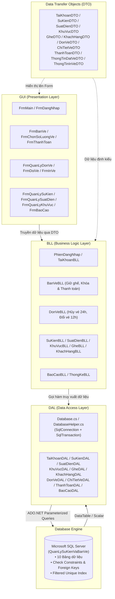

---

### 4.2. Cây thư mục dự án

```text
QuanLySuKienVaBanVe/
│
├── .github/
│   └── workflows/
│       └── build.yml                        # GitHub Actions CI: Restore NuGet, Build Release, chạy UnitTests
│
├── BLL/                                     # Tầng xử lý nghiệp vụ (Business Logic Layer)
│   ├── BanVe/
│   │   ├── BanVeBLL.cs                      # Nghiệp vụ giữ ghế, kiểm tra hạn giữ ghế, thanh toán trong Transaction
│   │   └── DonVeBLL.cs                      # Nghiệp vụ hủy vé (24h), đổi vé (12h), tính chênh lệch giá vé
│   ├── BaoCao/
│   │   ├── BaoCaoBLL.cs                     # Tổng hợp KPI báo cáo doanh thu, tỷ lệ lấp đầy & tăng trưởng
│   │   └── ThongKeBLL.cs                    # Truy xuất số liệu thống kê
│   ├── Core/
│   │   └── PhienDangNhap.cs                 # Quản lý phiên đăng nhập tĩnh của người dùng hiện hành
│   ├── KhachHang/
│   │   └── KhachHangBLL.cs                  # Kiểm tra định dạng SĐT, email, tìm kiếm bỏ dấu tiếng Việt
│   ├── KhuVuc/
│   │   ├── GheBLL.cs                        # Truy xuất danh sách ghế theo khu vực và suất diễn
│   │   └── KhuVucBLL.cs                     # Kiểm tra ràng buộc phân khu, đơn giá, sức chứa và sinh ghế
│   ├── SuKien/
│   │   ├── SuatDienBLL.cs                   # Kiểm tra ràng buộc thời gian lịch diễn, điều kiện xóa suất diễn
│   │   └── SuKienBLL.cs                     # Quản lý danh mục sự kiện
│   └── TaiKhoan/
│       └── TaiKhoanBLL.cs                   # Đăng nhập, băm mật khẩu SHA-256, khóa tạm khi sai mật khẩu, phân quyền
│
├── DAL/                                     # Tầng truy xuất dữ liệu (Data Access Layer)
│   ├── BanVe/
│   │   ├── ChiTietVeDAL.cs                  # Truy vấn, cấp phát mã vé MaVeCode, cập nhật trạng thái vé
│   │   ├── DonVeDAL.cs                      # Thao tác bảng DonVe và truy vấn lịch sử đơn vé
│   │   └── ThanhToanDAL.cs                  # Ghi nhận bản ghi thanh toán / hoàn tiền
│   ├── BaoCao/
│   │   ├── BaoCaoDAL.cs                     # Truy vấn dữ liệu doanh thu, tỷ lệ lấp đầy và cơ cấu hạng vé
│   │   └── ThongKeDAL.cs                    # Truy vấn thống kê tổng hợp
│   ├── Core/
│   │   ├── Database.cs                      # Lớp kết nối ADO.NET trung tâm, hỗ trợ Parameterized Query & SqlTransaction
│   │   └── DatabaseHelper.cs                # Lớp cầu nối tương thích ngược ủy quyền về Database.cs
│   ├── KhachHang/
│   │   └── KhachHangDAL.cs                  # CRUD khách hàng, tìm kiếm và kiểm tra trùng SĐT / khóa ngoại
│   ├── KhuVuc/
│   │   ├── GheDAL.cs                        # Giữ ghế theo MaPhienGiu, giải phóng ghế quá hạn, khóa ghế UPDLOCK
│   │   └── KhuVucDAL.cs                     # CRUD bảng KhuVuc và sinh ghế tự động theo sức chứa
│   ├── SuKien/
│   │   ├── SuatDienDAL.cs                   # CRUD bảng SuatDien
│   │   └── SuKienDAL.cs                     # CRUD bảng SuKien
│   └── TaiKhoan/
│       └── TaiKhoanDAL.cs                   # Truy vấn bảng TaiKhoan, cập nhật mật khẩu và trạng thái hoạt động
│
├── database/                                # Kịch bản Cơ sở dữ liệu Microsoft SQL Server
│   ├── 01_Schema.sql                        # Khởi tạo Database, 10 bảng, Check Constraints và Filtered Unique Index
│   ├── 02_SeedData.sql                      # Dữ liệu mẫu: 5 tài khoản, 5 sự kiện, 11 suất diễn, 106 phân khu, 2.900 ghế, 16 KH
│   ├── 03_DemoDashboard.sql                 # Dữ liệu mở rộng (tùy chọn): 16 sự kiện mô phỏng phục vụ biểu đồ Báo cáo
│   └── migrations/                          # Kịch bản nâng cấp CSDL dành cho database tạo từ phiên bản cũ
│       ├── 01_AddSchemaColumns.sql          # Bổ sung cột mở rộng (LoaiSoDo, ChoPhepBanVe, MaVung, MauSac...)
│       ├── 02_AddOrderConstraints.sql       # Bổ sung khóa ngoại MaDonGoc và chỉ mục lọc UQ_ChiTietVe_Ghe_HopLe
│       └── 03_AddSeatHoldAndZoneColor.sql   # Bổ sung MaPhienGiu, chỉ mục IX_Ghe_MaPhienGiu và chuẩn hóa màu sắc/MaVung
│
├── docs/                                    # Tài liệu hướng dẫn & Ảnh minh họa
│   ├── huong-dan-in-ve.md                   # Mô tả cấu trúc phôi vé và cách sử dụng module in vé
│   └── screenshots/                         # Chứa toàn bộ ảnh chụp màn hình giao diện thực tế và kết quả test
│
├── DTO/                                     # Đối tượng truyền dữ liệu (Data Transfer Objects)
│   ├── BanVe/                               # ChiTietVeDTO, DonVeDTO, ThanhToanDTO, ThongTinDatVeDTO
│   ├── BaoCao/                              # ThongTinInVeDTO
│   ├── KhachHang/                           # KhachHangDTO
│   ├── KhuVuc/                              # GheDTO, KhuVucDTO
│   ├── SuKien/                              # SuatDienDTO, SuKienDTO
│   └── TaiKhoan/                            # TaiKhoanDTO
│
├── GUI/                                     # Tầng giao diện người dùng (Presentation Layer)
│   ├── Controls/
│   │   └── FxControls.cs                    # Các custom controls hỗ trợ vẽ giao diện
│   ├── Forms/
│   │   ├── BanVe/                           # FrmBanVe, FrmChonSoLuongVe, FrmThanhToan
│   │   ├── BaoCao/                          # FrmBaoCao
│   │   ├── DonVe/                           # FrmQuanLyDonVe, FrmDoiVe, FrmInVe
│   │   ├── KhachHang/                       # FrmKhachHang, FrmChiTietKhachHang
│   │   ├── KhuVuc/                          # FrmQuanLyKhuVuc
│   │   ├── Main/                            # FrmDangNhap, FrmMain
│   │   ├── SuKien/                          # FrmQuanLySuKien, FrmChiTietSuKien, FrmQuanLySuatDien, FrmChiTietSuatDien
│   │   └── TaiKhoan/                        # FrmNhanVien, FrmQuanLyTaiKhoan, FrmTaiKhoan, FrmCaiDat, FrmNhatKy
│   └── Helpers/                             # HieuUng, IconHelper, InDanhSachKhach, Lang, ManagementFormLayout,
│                                            # ManagementGridRenderer, TicketPdfExporter, TicketRenderer, ZoneColorHelper
│
├── Resources/                               # Tài nguyên nhúng (Fonts Poppins, Icons, ảnh nền phôi vé Ticket)
├── UnitTests/                               # Dự án kiểm thử đơn vị tự động (MSTest, 36 tests)
├── App.config                               # Cấu hình chuỗi kết nối ConnStr và PerMonitorV2 DPI Awareness
├── packages.config                          # Khai báo gói NuGet: Guna.UI2, PDFsharp, ZXing.Net
├── Program.cs                               # Điểm khởi chạy ứng dụng và vòng lặp Đăng nhập <-> FrmMain
├── QuanLySuKienVaBanVe.csproj               # Tệp cấu hình project chính
└── QuanLySuKienVaBanVe.sln                  # Tệp Solution bao gồm ứng dụng chính và UnitTests
```

---

## 5. Yêu cầu môi trường (Prerequisites)

| Thành phần | Yêu cầu tối thiểu / Khuyến nghị | Ghi chú kỹ thuật |
| :--- | :--- | :--- |
| **Hệ điều hành** | Windows 10 (1809+) hoặc Windows 11 | Khuyến nghị đặt **Display Scale: 100% hoặc 125%**. `App.config` đã bật `PerMonitorV2`. |
| **Runtime / SDK** | **.NET Framework 4.7.2** | Cần Runtime để chạy bản `.exe` Release, hoặc Developer Pack để biên dịch mã nguồn. |
| **IDE phát triển** | Visual Studio 2022 | Cài đặt workload **.NET desktop development** và thành phần **MSTest** để chạy test. |
| **Hệ quản trị CSDL** | Microsoft SQL Server 2019 / 2022 | Hỗ trợ các bản Express, Developer hoặc Enterprise. |
| **Công cụ quản trị DB** | SQL Server Management Studio (SSMS) hoặc `sqlcmd` | Dùng để thực thi các kịch bản khởi tạo hoặc nâng cấp CSDL trong thư mục `database/`. |

---

## 6. Hướng dẫn cài đặt & Khởi chạy (Installation & Setup)

### 6.1. Thiết lập Cơ sở dữ liệu SQL Server (Bắt buộc cho cả 2 cách chạy)

Tùy theo trạng thái máy của bạn, hãy chọn **Cài đặt mới** hoặc **Nâng cấp từ CSDL cũ**:

#### Trường hợp A: Cài đặt CSDL mới từ đầu
Mở SSMS (hoặc dùng `sqlcmd`) và chạy lần lượt theo thứ tự:
1. **`database/01_Schema.sql`**: Tạo database `QuanLySuKienVaBanVe`, 10 bảng, các ràng buộc `CHECK` và chỉ mục lọc `UQ_ChiTietVe_Ghe_HopLe`.
2. **`database/02_SeedData.sql`**: Nạp dữ liệu mẫu gồm 5 tài khoản, 5 sự kiện, 11 suất diễn, 106 phân khu, 2.900 ghế, 16 khách hàng và 14 đơn vé.
3. **`database/03_DemoDashboard.sql`** *(Tùy chọn)*: Nạp thêm 16 sự kiện và 48 suất diễn mô phỏng để thử nghiệm biểu đồ trên màn hình `FrmBaoCao`.

Hoặc chạy nhanh bằng `sqlcmd` trong Command Prompt / PowerShell:
```powershell
sqlcmd -S . -E -i database\01_Schema.sql
sqlcmd -S . -E -i database\02_SeedData.sql
```

#### Trường hợp B: Nâng cấp từ CSDL phiên bản cũ
Nếu máy đã có sẵn database `QuanLySuKienVaBanVe` từ các nhánh trước và muốn giữ lại dữ liệu hiện có, hãy chạy lần lượt 3 file trong thư mục `database/migrations/`:
1. `database/migrations/01_AddSchemaColumns.sql`
2. `database/migrations/02_AddOrderConstraints.sql`
3. `database/migrations/03_AddSeatHoldAndZoneColor.sql`

*(Các script migration đều có kiểm tra điều kiện tồn tại, an toàn khi chạy lại).*

---

### 6.2. Cách 1: Biên dịch và chạy từ mã nguồn (Dành cho Developer)

1. **Clone repository:**
   ```bash
   git clone https://github.com/lekhoanohope-blip/QuanLySuKienVaBanVe.git
   cd QuanLySuKienVaBanVe
   ```
2. **Cấu hình chuỗi kết nối trong `App.config`:**
   Mở tệp `App.config` và điều chỉnh giá trị `Data Source` phù hợp với tên SQL Server trên máy:
   ```xml
   <connectionStrings>
     <add name="ConnStr" 
          connectionString="Data Source=.;Initial Catalog=QuanLySuKienVaBanVe;Integrated Security=True;Encrypt=False" 
          providerName="System.Data.SqlClient" />
   </connectionStrings>
   ```
   - Bản Default Instance: `Data Source=.` hoặc `Data Source=localhost`
   - Bản SQL Express: `Data Source=.\SQLEXPRESS`
3. **Khôi phục gói NuGet và Biên dịch:**
   - Mở `QuanLySuKienVaBanVe.sln` bằng Visual Studio 2022.
   - Nhấp chuột phải vào Solution $\rightarrow$ chọn **Restore NuGet Packages** (hoặc chạy lệnh `nuget restore QuanLySuKienVaBanVe.sln -PackagesDirectory packages`). Việc khôi phục ở cấp Solution sẽ tải đầy đủ cả thư viện giao diện lẫn gói `MSTest` cho dự án `UnitTests` vào thư mục `packages/` ở gốc.
   - Chọn **Build** $\rightarrow$ **Rebuild Solution**, sau đó nhấn **F5** để chạy ứng dụng.

---

### 6.3. Cách 2: Chạy trực tiếp bản đóng gói Release (Không cần Visual Studio)

**Điều kiện cần:** Máy tính chạy Windows đã có **.NET Framework 4.7.2 Runtime** và **SQL Server** đã chạy kịch bản khởi tạo CSDL ở mục **6.1**.

1. **Tải gói Release:**
   - Vào tab **Actions** trên GitHub repository $\rightarrow$ chọn workflow run thành công mới nhất $\rightarrow$ tải artifact **`QuanLySuKienVaBanVe-Release`** và giải nén ra thư mục bất kỳ.
   - *(Trong gói tải về đã đính kèm sẵn thư mục `database/` chứa các kịch bản SQL).*
2. **Cấu hình kết nối CSDL:**
   - Mở tệp `QuanLySuKienVaBanVe.exe.config` bằng Notepad.
   - Sửa `Data Source=.` trong thẻ `<connectionStrings>` thành tên SQL Server Instance trên máy của bạn và lưu lại.
3. **Khởi chạy:**
   - Chạy trực tiếp tệp **`QuanLySuKienVaBanVe.exe`**.

---

## 7. Tài khoản trải nghiệm (Demo Credentials)

Các tài khoản mẫu được khởi tạo sẵn trong `database/02_SeedData.sql` (mật khẩu lưu dưới dạng mã băm SHA-256):

| Tên đăng nhập | Mật khẩu | Vai trò (`VaiTro`) | Trạng thái | Phạm vi chức năng trên giao diện |
| :--- | :---: | :---: | :---: | :--- |
| **`admin`** | `123456` | `QuanLy` | Hoạt động | Quản lý Sự kiện, Suất diễn, Khu vực & Giá vé, Khách hàng, Nhân sự/Tài khoản, Báo cáo & Thống kê. |
| **`quanly_sukien`** | `123456` | `QuanLy` | Hoạt động | Tài khoản Quản lý dự phòng phục vụ kiểm thử phân quyền quản trị. |
| **`staff`** | `123456` | `NhanVien` | Hoạt động | Nghiệp vụ quầy vé: Bán vé & Giữ ghế (`FrmBanVe`), Quản lý đơn vé (`FrmQuanLyDonVe`), Đổi vé (`FrmDoiVe`), Hủy vé và In vé/Xuất PDF (`FrmInVe`). |
| **`nhanvien_quay1`** | `123456` | `NhanVien` | Hoạt động | Tài khoản Nhân viên quầy vé thứ hai (dùng để kiểm thử giữ ghế đồng thời giữa 2 phiên làm việc). |
| **`nhanvien_khoa`** | `123456` | `NhanVien` | Đã khóa (`0`) | Dùng để kiểm thử kịch bản từ chối đăng nhập khi tài khoản bị vô hiệu hóa. |

---

## 8. Xử lý lỗi thường gặp trên WinForms (Troubleshooting)

### 1. Lỗi kết nối Cơ sở dữ liệu SQL Server (`SqlException`)
- **Nguyên nhân:** Dịch vụ SQL Server chưa chạy, sai tên `Data Source` trong `App.config`, hoặc chưa thực thi `01_Schema.sql`.
- **Cách khắc phục:**
  1. Mở `services.msc`, kiểm tra dịch vụ `SQL Server (MSSQLSERVER)` hoặc `SQL Server (SQLEXPRESS)` đang ở trạng thái **Running**.
  2. Đối chiếu tên Server khi đăng nhập SSMS và cập nhật lại `Data Source` trong `App.config` (hoặc `QuanLySuKienVaBanVe.exe.config`), giữ nguyên tham số `Encrypt=False`.

### 2. Lỗi khóa tệp `.resx` khi tải mã nguồn dạng `.zip` (Mark of the Web)
- **Triệu chứng:** Visual Studio báo lỗi *"Couldn't process file ...resx due to its being in the Internet or Restricted zone"*.
- **Cách khắc phục:** Mở PowerShell tại thư mục gốc của dự án và chạy:
  ```powershell
  Get-ChildItem -Path . -Recurse | Unblock-File
  ```

### 3. Lỗi thiếu gói NuGet khi mở Form Designer hoặc build `UnitTests`
- **Triệu chứng:** Báo lỗi thiếu namespace `Guna`, `PdfSharp`, `ZXing` hoặc `Microsoft.VisualStudio.TestTools.UnitTesting`.
- **Cách khắc phục:** Khôi phục gói ở cấp Solution để toàn bộ thư viện được tải về thư mục `packages/` tại gốc dự án:
  ```powershell
  nuget restore QuanLySuKienVaBanVe.sln -PackagesDirectory packages
  ```
  Sau đó đóng các tab Designer đang mở, thực hiện **Clean Solution** và **Rebuild Solution**.

---

## 9. Kiểm thử (Testing) & Thành viên thực hiện

### 9.1. Kiểm thử tự động (Unit Tests)

Dự án tích hợp project **`UnitTests`** sử dụng **MSTest v2.2.10** gồm **36 ca kiểm thử tự động** chạy độc lập trong bộ nhớ (không yêu cầu kết nối SQL Server), tập trung kiểm tra các hàm xử lý logic và kiểm tra dữ liệu đầu vào ở tầng `BLL` và `DTO`:

| Tệp kiểm thử | Số lượng | Nội dung kiểm thử thực tế |
| :--- | :---: | :--- |
| `DangNhapPhanQuyenTests.cs` | 8 tests | Kiểm tra từ chối đăng nhập khi thiếu tên đăng nhập/mật khẩu hoặc chỉ nhập khoảng trắng; kiểm tra tính nhất quán và độ dài 64 ký tự hex của hàm băm `TaiKhoanBLL.BamMatKhau`; kiểm tra trạng thái phiên và phân quyền `QuanLy` / `NhanVien` trên `PhienDangNhap`. |
| `BanVeDoiVeTests.cs` | 7 tests | Kiểm tra `BanVeBLL.XuLyThanhToan` từ chối đầu vào `null` hoặc danh sách ghế rỗng; kiểm tra khởi tạo `DonVeResult.Ok` / `Fail`; kiểm tra hàm `DonVeBLL.TinhChenhLech` trong 3 trường hợp đổi vé ngang giá ($\Delta = 0$), nâng hạng ($\Delta > 0$) và hạ hạng ($\Delta < 0$). |
| `KhachHangNghiepVuTests.cs` | 6 tests | Kiểm tra validation khi thêm/sửa khách hàng (`null`, tên rỗng, SĐT rỗng, `MaKH <= 0`) và kiểm tra hàm chuẩn hóa chuỗi bỏ dấu tiếng Việt `KhachHangBLL.LoaiBoDauTiengViet`. |
| `SuKienSuatDienTests.cs` | 9 tests | Kiểm tra validation khi thêm sự kiện (`null`, tên trống), thêm suất diễn (`null`, chưa chọn sự kiện, thiếu địa điểm, `ThoiGianKetThuc <= ThoiGianBatDau`) và thêm khu vực (giá vé âm, sức chứa $\le 0$ hoặc vượt ngưỡng $> 2.600$). |
| `BaoCaoThongKeTests.cs` | 6 tests | Kiểm tra hàm tự động hoán đổi thứ tự ngày `BaoCaoBLL.ChuanHoaNgay`, hàm tính phần trăm tăng trưởng `BaoCaoBLL.TinhTangTruong` (xử lý mẫu số bằng 0 trả về `null`, tăng trưởng dương, tăng trưởng âm) và khởi tạo `KpiBaoCao`. |

> **Giới hạn phạm vi kiểm thử hiện tại:**
> - Bộ 36 unit tests trên kiểm tra logic thuần (in-memory validation & tính toán), **chưa kiểm thử tự động các luồng phụ thuộc trực tiếp vào SQL Server** (như giao dịch giữ ghế/thanh toán thực tế, kiểm tra điều kiện thời gian hủy vé 24h / đổi vé 12h từ dữ liệu DB, giải phóng ghế quá hạn 10 phút, truy vấn doanh thu/tỷ lệ lấp đầy bằng SQL) cũng như **bố cục hiển thị các Form**. Các luồng này hiện được kiểm thử chức năng trực tiếp trên ứng dụng với bộ dữ liệu `02_SeedData.sql`.

#### Kết quả thực thi kiểm thử trên Visual Studio Test Explorer:
Toàn bộ **36 ca kiểm thử** đều vượt qua thành công (**Passed 36/36**) trên Test Explorer của Visual Studio:

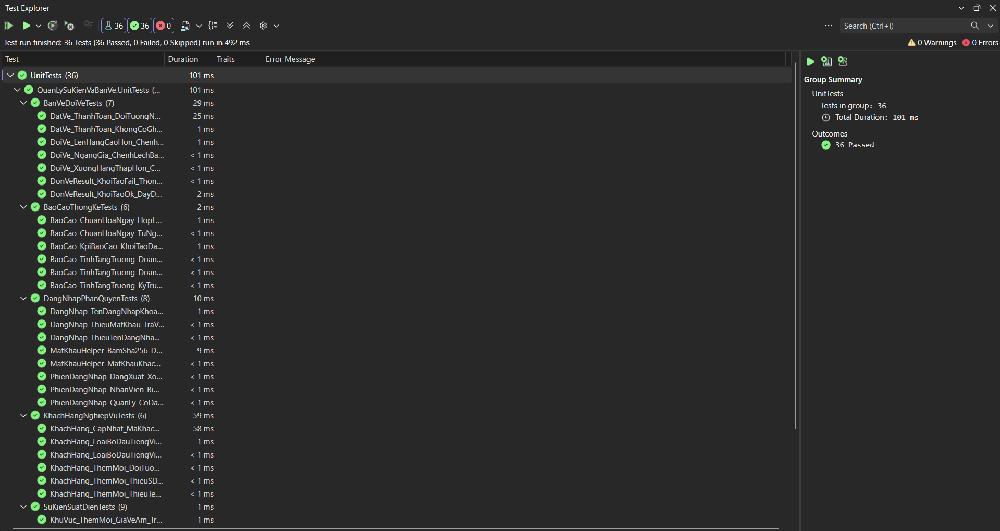

#### Điều kiện và cách chạy Unit Tests từ dòng lệnh:
1. Đảm bảo đã chạy `nuget restore` cho Solution và biên dịch dự án ở cấu hình `Release` (hoặc `Debug`).
2. Chạy kiểm thử bằng `dotnet test` hoặc `vstest.console.exe`:
   ```powershell
   dotnet test UnitTests/bin/Release/QuanLySuKienVaBanVe.UnitTests.dll --verbosity normal
   ```

---

### 9.2. Thông tin nhóm thực hiện & Phân công nhiệm vụ

Dự án được thực hiện bởi **Nhóm 3** — Lớp học phần Lập trình Windows (COMP1019), Khoa Công nghệ Thông tin, Trường Đại học Sư phạm TP.HCM (thông tin đối chiếu theo lịch sử commit GitHub và báo cáo nhóm):

| STT | Họ và tên | MSSV | Tài khoản GitHub | Phân hệ phụ trách & Đóng góp thực tế |
| :---: | :--- | :---: | :---: | :--- |
| 1 | **Lê Minh Tài** | 51.01.104.087 | [`TaiLe8989`](https://github.com/TaiLe8989) | • Xây dựng phân hệ Đăng nhập, xác thực băm mật khẩu SHA-256 và phân quyền phiên làm việc (`FrmDangNhap`, `PhienDangNhap`).<br>• Xây dựng phân hệ Quản lý Tài khoản / Nhân viên (`FrmNhanVien`, `TaiKhoanBLL`, `TaiKhoanDAL`).<br>• Triển khai ban đầu phân hệ In vé GDI+ và xuất PDF (`FrmInVe`, `TicketRenderer.cs`, `TicketPdfExporter.cs`) cùng các Form khung tài khoản/nhật ký. |
| 2 | **Lê Trần Anh Khoa** *(Nhóm trưởng)* | 51.01.104.044 | [`lekhoanohope-blip`](https://github.com/lekhoanohope-blip) | • Xây dựng phân hệ Quản lý Sự kiện & Suất diễn (`FrmQuanLySuKien`, `FrmChiTietSuKien`, `FrmQuanLySuatDien`, `FrmChiTietSuatDien`) và tiện ích in danh sách khách tham dự (`InDanhSachKhach.cs`).<br>• Xây dựng phân hệ Quản lý Khu vực & Bảng giá vé (`FrmQuanLyKhuVuc`, `KhuVucBLL`, `KhuVucDAL`).<br>• Xây dựng phân hệ Báo cáo & Thống kê biểu đồ (`FrmBaoCao`, `BaoCaoBLL`, `BaoCaoDAL`).<br>• Thiết kế giao diện điều hướng `FrmMain`, bộ hiệu ứng giao diện (`HieuUng.cs`, `FxControls.cs`) và hoàn thiện phần in vé. |
| 3 | **Đặng Hoàng Bảo Huy** | 51.01.104.033 | [`huydhb`](https://github.com/huydhb) | • Xây dựng phân hệ Quản lý Khách hàng (`FrmKhachHang`, `FrmChiTietKhachHang`, `KhachHangBLL`, `KhachHangDAL`).<br>• Xây dựng phân hệ Bán vé tại quầy, giữ ghế tạm thời và thanh toán trong `SqlTransaction` (`FrmBanVe`, `FrmChonSoLuongVe`, `FrmThanhToan`, `BanVeBLL`, `GheDAL`).<br>• Xây dựng phân hệ Quản lý Đơn vé, Hủy vé (24h) và Đổi vé (12h) (`FrmQuanLyDonVe`, `FrmDoiVe`, `DonVeBLL`, `DonVeDAL`).<br>• Chuẩn hóa kịch bản CSDL (`01_Schema.sql`, `02_SeedData.sql`, `migrations/`), tích hợp & sửa lỗi liên phân hệ, tái cấu trúc thư mục 3-Tier và thiết lập `UnitTests` / GitHub Actions CI. |

---

> **Bản quyền & Giấy phép:** Dự án phục vụ mục đích học tập trong khuôn khổ môn học Lập trình Windows tại Trường Đại học Sư phạm TP.HCM (HCMUE). Mọi góp ý kỹ thuật vui lòng tạo Issue trên [GitHub Repository](https://github.com/lekhoanohope-blip/QuanLySuKienVaBanVe/issues).
